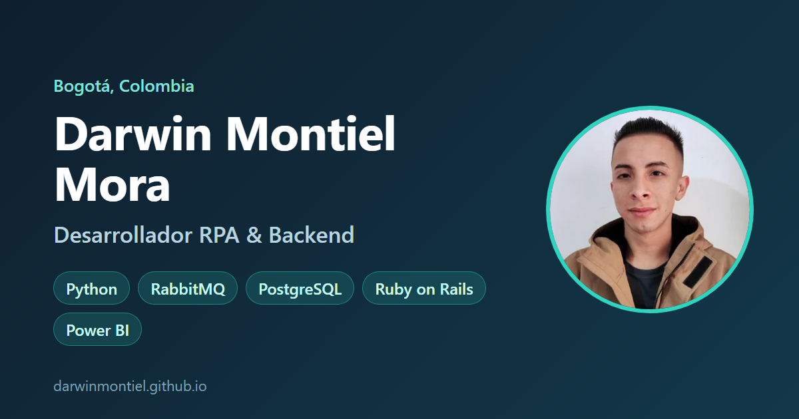

# darwinmontiel.github.io

[](https://github.com/DarwinMontiel/DarwinMontiel.github.io/actions/workflows/ci.yml)

Sitio de portafolio de **Darwin Montiel Mora**, Desarrollador RPA & Backend:
**https://darwinmontiel.github.io**



## Características

- HTML semántico, CSS propio y unas pocas líneas de JavaScript: **sin frameworks, sin
  dependencias y sin rastreadores** de terceros.
- Modo claro y oscuro (respeta la preferencia del sistema y recuerda la elección).
- Responsive, accesible (navegación por teclado, enlace para saltar al contenido,
  `prefers-reduced-motion`) e imágenes WebP optimizadas con carga diferida.
- SEO: metadatos Open Graph para compartir en LinkedIn, datos estructurados `schema.org/Person`,
  `sitemap.xml` y `robots.txt`.
- CI: validación de HTML y verificación semanal de enlaces rotos.

## Desarrollo local

```bash
python -m http.server 8000     # http://localhost:8000
npx html-validate@9 index.html 404.html
```

GitHub Pages publica automáticamente la rama `main`.

## Proyectos enlazados

[rpa-orchestrator](https://github.com/DarwinMontiel/rpa-orchestrator) ·
[cartera-analytics](https://github.com/DarwinMontiel/cartera-analytics) ·
[cartera-crm](https://github.com/DarwinMontiel/cartera-crm) ·
[llm-gateway](https://github.com/DarwinMontiel/llm-gateway) ·
[robocorp-order-robot](https://github.com/DarwinMontiel/robocorp-order-robot) ·
[tu-amigo-viajero](https://github.com/DarwinMontiel/tu-amigo-viajero)

Código bajo licencia [MIT](LICENSE). El contenido (textos, foto) es de Darwin Montiel Mora.
